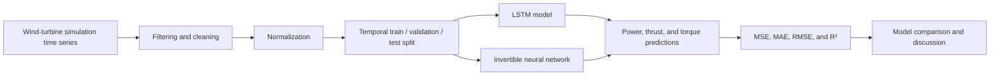

# Wind-Turbine Performance Prediction with Neural Networks

### Master's thesis comparing LSTM and invertible neural-network approaches for multivariate time-series prediction

> [!IMPORTANT]
> This is a public documentation-only showcase. The implementation, simulation dataset, thesis report, trained weights, and detailed experimental artifacts are intentionally withheld because they contain confidential material.

## Overview

This master's thesis investigated data-driven prediction of wind-turbine performance from time-series simulation data. The work compared Long Short-Term Memory (LSTM) networks with Invertible Neural Networks (INNs) for forecasting key turbine quantities, including generated power, rotor thrust, and rotor torque.

The research covered data filtering, normalization, temporal sample construction, model development, hyperparameter experimentation, quantitative evaluation, and comparison of actual and predicted turbine responses.

## Research Objectives

- Predict multiple wind-turbine performance variables from simulation time series.
- Compare a sequence-oriented LSTM baseline with an invertible architecture.
- Study model accuracy, stability, and generalization across operating scenarios.
- Evaluate predictions using regression metrics and time-series visualizations.
- Examine the strengths and limitations of both model families for engineering applications.

## Features

- Multivariate time-series preprocessing
- Data filtering, cleaning, normalization, and partitioning
- LSTM-based sequence prediction
- Invertible neural networks built with FrEIA
- Training and validation loss analysis
- Multi-output regression evaluation
- Actual-versus-predicted visualization
- Comparative discussion of model behavior and limitations

## Architecture



### Model Paths

**LSTM path:** Sequential time windows are processed by recurrent layers to learn temporal dependencies and predict future turbine responses.

**INN path:** Coupling-based invertible transformations model the relationship between operating inputs and turbine outputs while preserving a reversible latent representation.

## Public Repository Contents

```text
.
├── README.md          # Public project overview
├── Title.md           # Thesis title information
└── requirements.txt   # Historical development dependencies
```

The public repository intentionally does not contain the private source code or research assets.

## Setup

There is no public executable setup because the implementation and data are confidential. The historical development stack is recorded in `requirements.txt` for technology transparency, but that file is not presented as a reproducible public environment.

Authorized users should use the private project documentation, approved dataset location, and internally maintained environment instructions.

## Usage

The public repository is intended for portfolio review and high-level technical discussion. It can be used to understand:

- The engineering problem addressed by the thesis
- The two model families compared
- The evaluation approach
- The principal tools used during development

It cannot be used to train or reproduce the thesis models without the confidential implementation and simulation data.

## Results

The study evaluated model behavior using:

- Mean Squared Error (MSE)
- Mean Absolute Error (MAE)
- Root Mean Squared Error (RMSE)
- Coefficient of determination (R²)
- Training and validation loss curves
- Actual-versus-predicted time-series plots

Detailed numeric results and experiment artifacts are not published because they are tied to confidential data and thesis materials. The public summary therefore avoids unsupported or non-reproducible benchmark claims.

## Technology Stack

| Area | Technology |
| --- | --- |
| Language | Python |
| Deep learning | PyTorch |
| Invertible models | FrEIA |
| Data processing | NumPy, pandas |
| Machine-learning utilities | scikit-learn |
| Visualization | Matplotlib, Plotly |

## Limitations

- Source code, datasets, trained weights, and detailed results are not publicly available.
- Public reproduction is intentionally not supported because of confidentiality restrictions.
- Model behavior depends on the turbine model, simulation assumptions, operating ranges, sampling strategy, and preprocessing choices.
- Conclusions from simulation data require additional validation before transfer to real operational turbine data.
- The public repository provides architectural and methodological context, not a production forecasting service.

## Confidentiality Notice

This repository grants no access to the private implementation or underlying research data. Please contact the repository owner through GitHub for high-level questions, authorized demonstrations, or collaboration inquiries.
